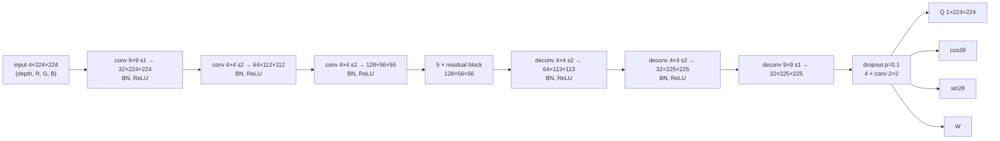

# Model architecture (summary)

Full derivations, tensor shapes and design rationale are in `technical_report.md`, Chapter 5.

Both models map an input `x ∈ R^{B×C×224×224}` (C = 4 for RGB-D, 3 for RGB) to four dense maps
of the same spatial size: grasp quality `Q`, `cos 2θ`, `sin 2θ` and normalised width `W`.
The heads (`models/heads.py`) are shared code: four parallel 2×2 convolutions with no output
activation, preceded by optional dropout.

| | GG-CNN (baseline) | GR-ConvNet (main) |
|---|---|---|
| Source | Morrison et al., RSS 2018 | Kumra et al., IROS 2020 |
| Encoder | 3 strided convs 9×9/3, 5×5/2, 3×3/2 (32, 16, 8 ch) | 9×9/1, 4×4/2, 4×4/2 (32, 64, 128 ch) + BN |
| Bottleneck | none (8 channels at 19×19) | 5 residual blocks at 128×56×56 |
| Decoder | 3 transposed convs (mirror) + bilinear resize to 225×225 | 3 transposed convs + BN |
| Parameters (RGB-D input) | 70,196 | 1,900,900 |
| Loss (identical) | sum of Smooth-L1 over the 4 maps | same |

Parameter counts printed by `scripts/train.py` (`model parameters:` log line). GR-ConvNet's count
equals the 1,900,900 reported in the paper.
