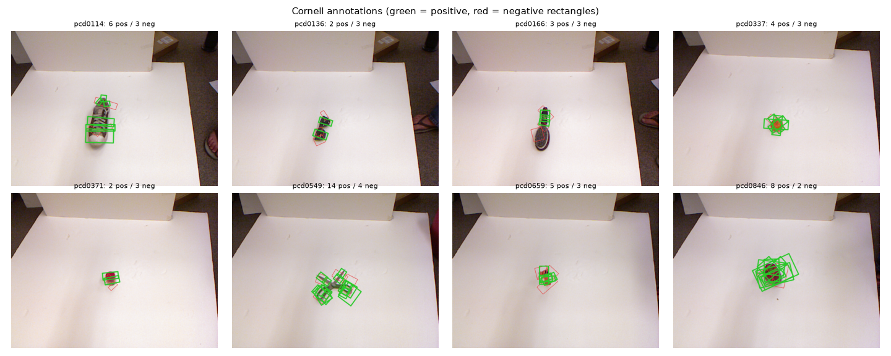
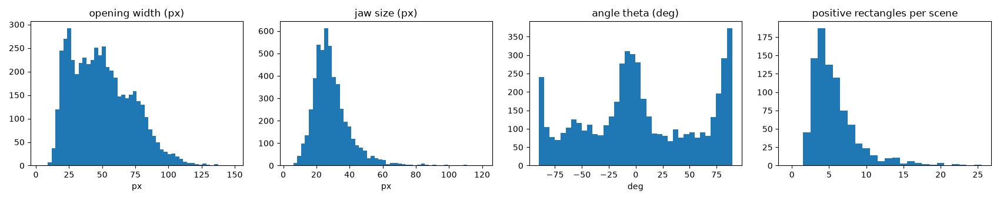
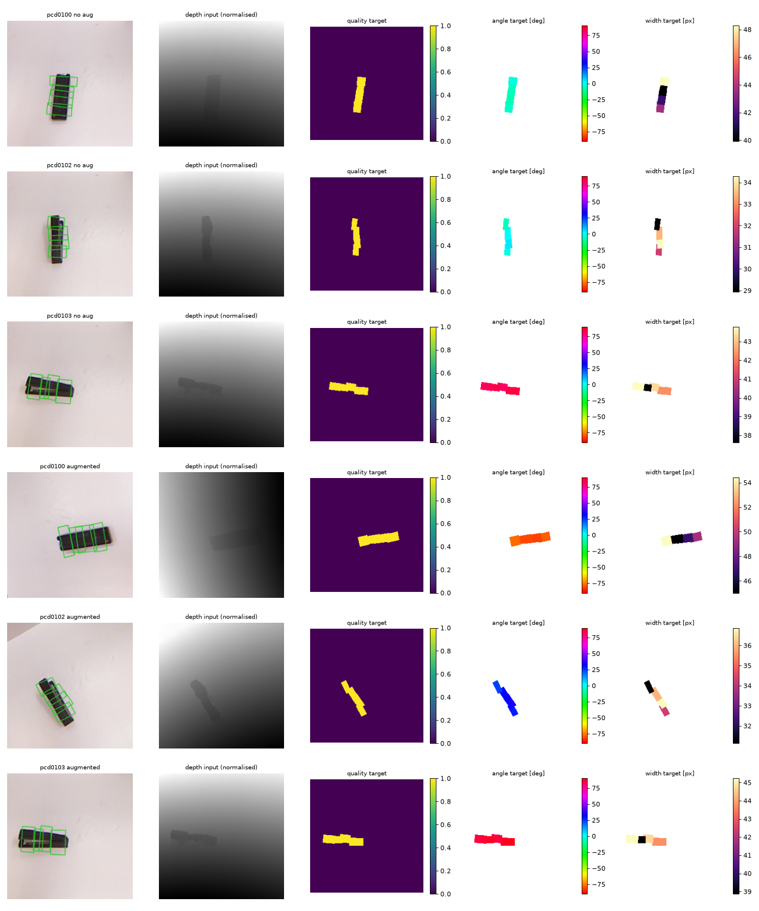
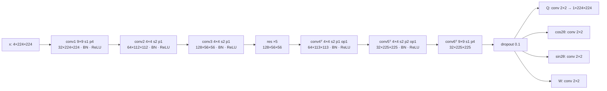
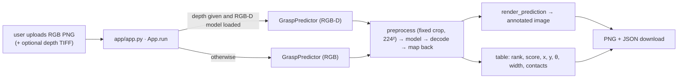

# Vision-Based Robotic Grasp Planner — Technical Report and Textbook

*Planar parallel-jaw grasp detection on the Cornell Grasping Dataset with GG-CNN and GR-ConvNet.*

> **How to read this document.** Chapters 2–4 explain the problem and the mathematics, with
> worked examples computed by the project's own code. Chapters 5–8 walk through the
> implementation and quote the real source (every quoted block carries a `src:` tag that
> `scripts/check_report.py` verifies against the repository). Chapter 9 reports the measured
> results. Every number tagged `num:` is checked against the JSON file it came from. Read it next
> to the code: Appendix H maps each chapter to its files.

<!-- EXECUTIVE SUMMARY INSERTED BELOW -->
## 1. Executive Summary

_(written after the final evaluation; see the end of the document build)_

---

## 2. Problem Formulation

### 2.1 What robotic grasp detection is

A robot that has to pick up an object must decide **where** to put its fingers and **how** to
orient them. *Grasp detection* is the perception part of that decision: given sensor data
(here an RGB image and a depth image taken from above), output one or more **grasp
configurations** that would let the gripper hold the object. In this project the gripper is a
**parallel-jaw gripper**: two flat plates that move towards each other along one line until they
touch the object. That is the most common industrial and research gripper.

Grasp detection is *not* the whole grasping pipeline. A complete system also needs (i) camera
calibration to convert image pixels into 3-D robot coordinates, (ii) motion planning to reach
the grasp without collisions, (iii) control to close the gripper and lift, and (iv) a check that
the object was actually lifted. This project implements only the image-level detection step
and evaluates it against human annotations. Section 2.5 makes the distinction precise.

### 2.2 Parallel-jaw geometry and the grasp rectangle

Jiang, Moseson and Saxena [Jiang 2011] proposed representing a top-down parallel-jaw grasp as
an **oriented rectangle in the image plane**:

```
            jaw plate (p1 → p2)
     p0 ────────────────────── p1         ← edge p0→p1: the closing direction,
      │            ↔            │            its length = gripper opening "width" w
      │         centre c        │
      │                         │
     p3 ────────────────────── p2
            jaw plate (p3 → p0)            ← edge p1→p2: a jaw plate, length = "jaw size" h
```

Two sides of the rectangle are the gripper plates. The other two sides join the plates and
lie along the **closing direction**. A rectangle has five degrees of freedom:

| Symbol | Meaning | Unit |
|---|---|---|
| `x, y` | rectangle centre = midpoint between the two plates | pixels |
| `θ` | angle of the closing direction | radians / degrees |
| `w` | opening: distance between the plates | pixels |
| `h` | jaw size: length of each plate | pixels |

The networks in this project predict `(x, y, θ, w)` plus a **quality score** `q` at every pixel.
They do **not** predict `h`. When a predicted grasp must be drawn or compared as a rectangle,
`h = w/2` is used, the same convention as the GG-CNN and GR-ConvNet reference code.

### 2.3 Contact points

The two **contact points** are where the plates' centres meet the object's outline, at half
the opening on either side of the centre along the closing direction:

$$\mathbf{c}_{1,2} = (x, y) \mp \tfrac{w}{2}\,\mathbf{d}, \qquad \mathbf{d} = (\cos\theta,\; -\sin\theta).$$

The minus sign in `d` comes from the image coordinate convention (next section). For the first
positive rectangle of scene 0100 (worked example in §3.3) the contact points are
(252.0, 332.7) and (308.0, 337.0). These are exactly the midpoints of the two plate edges.

### 2.4 Coordinate and angle conventions (used everywhere in the code)

* **Pixels.** Origin at the **top-left** corner; `x` = column, growing to the right; `y` = row,
  growing **downwards**. Cornell files store vertices as `x y`.
* **Angle.** `θ` is the direction of the closing line (`p0 → p1`), measured
  **counter-clockwise from the +x axis as seen on the screen**. Because `y` grows downwards,
  a vector `(dx, dy)` has on-screen angle `atan2(−dy, dx)`.
* **Symmetry.** Rotating a parallel-jaw grasp by 180° gives the same physical grasp, so `θ` is
  wrapped to `[−π/2, π/2)`, i.e. [−90°, 90°).
* **Width.** `w` is the opening in pixels of whichever image is being discussed. The network's
  input is a resized crop, so widths are converted whenever coordinates change (§3.4).

<!-- src: src/grasp_planner/data/grasp.py -->
```python
def wrap_angle(theta: float | np.ndarray) -> float | np.ndarray:
    """Wrap an angle (radians) to ``[-pi/2, pi/2)``, the canonical range of a grasp angle."""
    return (theta + HALF_PI) % np.pi - HALF_PI


def angle_difference(a: float, b: float) -> float:
    """Smallest absolute difference between two grasp angles, respecting the pi symmetry.

    Result is in ``[0, pi/2]``. Example: 80 deg vs -80 deg -> 20 deg.
    """
    d = abs(a - b) % np.pi
    return float(min(d, np.pi - d))
```

`wrap_angle` shifts by π/2, takes the remainder modulo π (Python's `%` always returns a value in
`[0, π)` for a positive modulus) and shifts back. `angle_difference` first reduces the raw
difference modulo π, then takes the shorter way round. 80° and −80° differ by 160°, which is
the same orientation as a 20° difference.

### 2.5 What a 2-D grasp prediction is — and is not

| Level | What it gives | Done here? |
|---|---|---|
| 2-D planar grasp (this project) | `(x, y, θ, w)` in image pixels + a score | **yes** |
| 3-D grasp pose | gripper position and orientation in the camera or robot frame (6-DoF + opening) | **no**; needs depth back-projection with camera intrinsics, plus a camera-to-robot transform |
| Executable grasp | 3-D pose + collision-free approach trajectory | **no** |
| Physically verified grasp | the robot lifted the object | **no**; no robot was used |

A prediction that passes the Cornell rectangle metric is a **geometrically plausible** grasp:
it overlaps a human-labelled good grasp and has a similar orientation. It is **not** evidence
that a robot would succeed. Nothing in this report claims physical grasp success.

---

## 3. Dataset and Data Engineering

### 3.1 The Cornell Grasping Dataset

Cornell [Jiang 2011] contains 885 RGB-D scenes. Each shows a single household object on a
white board, photographed from above by a Kinect-style sensor. Every scene has hand-labelled
**positive** (good) and **negative** (bad) grasp rectangles. It is small by deep-learning
standards, which shapes many decisions below (augmentation, a light model, early stopping).

### 3.2 The local copy: structure verified by inspection

`scripts/inspect_dataset.py` walks the dataset folder **read-only** and writes
`experiments/results/dataset_stats.json`. Findings:

| Item | Finding |
|---|---|
| Scene folders | `01`–`08` with 100 scenes each, `09` with 50, `10` with 35 → <!-- num: experiments/results/dataset_stats.json:num_usable_scenes -->885 usable scenes |
| Files per scene | `pcdXXXXr.png` (RGB), `pcdXXXXd.tiff` (depth), `pcdXXXXcpos.txt`, `pcdXXXXcneg.txt`, `pcdXXXX.txt` (point cloud) |
| Other | `backgrounds/` with <!-- num: experiments/results/dataset_stats.json:num_background_images -->11 object-free RGB images (no annotations) |
| RGB | 640 × 480 × 3, uint8, all 885 |
| Depth | float32, 640 × 480, metres; median depth ≈ 1.1–1.2 m |
| Positive rectangles | <!-- num: experiments/results/dataset_stats.json:positive_rectangles.total -->5110 valid (2–25 per scene) |
| Negative rectangles | <!-- num: experiments/results/dataset_stats.json:negative_rectangles.total -->2909 |
| Rejected rectangles | <!-- num: experiments/results/dataset_stats.json:rejected_rectangles -->1 (`pcd0165cpos.txt` #2 has `NaN` coordinates) |
| Excluded scenes | <!-- num: experiments/results/dataset_stats.json:num_excluded_scenes -->0 |
| Object identities | not available: the original `z.txt` object mapping is absent |

The depth TIFFs are not part of the original Cornell download. They are the dense depth images
produced from the point clouds by the GG-CNN repository's conversion script, and were already
present in the local copy. They have no missing pixels, but about 0.01 % of pixels per image (in
the image corners, outside the crop) have depths of a few millimetres. A Kinect cannot measure
that, so they are artefacts. The loader treats any depth below 0.3 m as invalid and inpaints it.


*Figure 3.1 — Eight random scenes with positive (green) and negative (red) rectangles, drawn
from the parsed files by `scripts/inspect_dataset.py`.*


*Figure 3.2 — Distribution of opening width, jaw size, angle and rectangles per scene over all
valid positive rectangles.*

### 3.3 Parsing a rectangle — a worked example

The first four lines of `pcd0100cpos.txt` are

```
253 319.7
309 324
307 350
251 345.7
```

so `p0 = (253, 319.7)`, `p1 = (309, 324)`, `p2 = (307, 350)`, `p3 = (251, 345.7)`.
`rect_to_grasp` converts this to the grasp representation:

<!-- src: src/grasp_planner/data/grasp.py -->
```python
    dx, dy = pts[1] - pts[0]
    theta = wrap_angle(float(np.arctan2(-dy, dx)))
    width = float(np.hypot(dx, dy))
    jaw_size = float(np.linalg.norm(pts[2] - pts[1]))
    cx, cy = pts.mean(axis=0)
```

* `dx, dy = 56, 4.3` → `θ = atan2(−4.3, 56) = −4.39°`. The closing line points slightly
  *down* on screen, so the angle is slightly negative.
* `w = √(56² + 4.3²) = 56.16 px`, `h = |p2 − p1| = √(2² + 26²) = 26.08 px`.
* Centre `= mean of the vertices = (280.00, 334.85)`.
* Visual check (Figure 3.1 style overlay of scene 0100): the rectangle spans the remote control
  across its narrow side. So `p0→p1` really is the closing direction, which confirms the
  convention.

**Validation.** `parse_rectangle_file` (`data/cornell.py`) checks that the file has a multiple
of four lines and parses every value. `rectangle_geometry_errors` (`data/grasp.py`) then
rejects a rectangle that has non-finite coordinates, a zero-length side, or a corner more than
10° away from a right angle (hand labels are only approximately rectangular). A vertex outside
the 640 × 480 image is also rejected. Rejected rectangles are **listed** in `sample.issues`,
logged as warnings and written to `dataset_exclusions.json`; they are never dropped silently.
A scene left with no valid positive rectangle would be excluded with a reason. That did not
happen.

### 3.4 Preprocessing: one affine map for everything

The network sees a **224 × 224** image. To get there from 640 × 480, a fixed square window is
cropped and resized. During training it is also randomly rotated, zoomed, shifted and
mirrored. The project composes **all** of these into a single 2 × 3 affine matrix `M`:

$$\begin{pmatrix}x'\\y'\end{pmatrix} = \underbrace{s\,F\,R(\alpha)}_{A}\begin{pmatrix}x-c_x\\y-c_y\end{pmatrix} + \begin{pmatrix}\tfrac{S-1}{2}\\\tfrac{S-1}{2}\end{pmatrix},\qquad
R(\alpha) = \begin{pmatrix}\cos\alpha & \sin\alpha\\ -\sin\alpha & \cos\alpha\end{pmatrix},$$

where `(c_x, c_y)` is the crop centre (plus a random shift during training), `s = S / (L·z)`
is the scale for crop side `L`, output size `S` and zoom factor `z`, `F = diag(−1, 1)` if
mirrored (else the identity), and `α` is the rotation angle. `R(α)` is a **counter-clockwise
rotation as seen on screen** in a y-down frame. That is why its signs differ from the textbook
y-up rotation matrix.

<!-- src: src/grasp_planner/data/transforms.py -->
```python
    cx, cy = crop.cx + shift[0], crop.cy + shift[1]
    s = output_size / (crop.size * zoom)
    c, sn = np.cos(rotation_rad), np.sin(rotation_rad)
    rot = np.array([[c, sn], [-sn, c]])
    lin = s * rot
    if hflip:
        lin = np.diag([-1.0, 1.0]) @ lin
    half = (output_size - 1) / 2.0
    t = np.array([half, half]) - lin @ np.array([cx, cy])
    return np.hstack([lin, t[:, None]])
```

**Why one matrix?** The image is resampled once with `cv2.warpAffine(img, M)`. The rectangle
**vertices** are transformed with the same `M`, and `(x, y, θ, w)` is then *recomputed* from
the transformed vertices with `rect_to_grasp`. Because labels and pixels go through exactly
the same mapping, they cannot drift apart. No separate formula is needed for "how does θ change
under a flip", which is a classic source of bugs. The consequences follow from the algebra:

* rotation by α adds α to θ: `R(α)(cos θ, −sin θ)ᵀ = (cos(θ+α), −sin(θ+α))ᵀ`;
* the mirror `F` maps `(cos θ, −sin θ)` to `(−cos θ, −sin θ)`, which is the direction of `−θ`
  modulo π. So mirroring negates the angle;
* every length, including the opening `w`, is multiplied by `s`.

**Worked example** (computed by the code). With the chosen crop `c = (304, 275)`, `L = 288`,
`S = 224`: `s = 224/288 = 0.7778`, and

`M = [[0.7778, 0, −124.94], [0, 0.7778, −102.39]]`.

The scene-0100 grasp from §3.3 maps to centre (92.83, 158.05), `w = 43.68 px` and unchanged
`θ = −4.39°`. Adding a 90° rotation gives centre (158.05, 130.17) and `θ = 85.61°` (= −4.39° +
90°), with the same width. `tests/test_transforms.py` checks these identities, and also paints
a rectangle into an image, warps it, and checks the blob's centroid and principal axis against
the transformed grasp. That catches any mismatch between the pixel path and the label path.

**The crop window** is fixed and was chosen **only from training annotations**
(`scripts/make_splits.py`, written to `experiments/results/crop_analysis.json`). Its centre is
the median training grasp centre, (304, 275). Its side is the smallest multiple of 16 px that
contains at least 99 % of training rectangle vertices: 288 px. On the training split it covers
<!-- num: experiments/results/crop_analysis.json:chosen_train_coverage.vertex_fraction:.1% -->99.4% of
vertices and <!-- num: experiments/results/crop_analysis.json:chosen_train_coverage.rectangle_fraction:.1% -->98.4% of
whole rectangles. The GR-ConvNet reference code instead centres each crop on the **ground-truth
grasps of that image**. That is a mild form of label leakage at test time: the network is
always shown the object in the middle. The fixed window avoids it, at the cost of seeing a
little more background.

**Depth.** The pipeline masks invalid pixels (< 0.3 m), fills them by Navier–Stokes inpainting
(`cv2.INPAINT_NS` [Bertalmio 2001]), subtracts the per-image mean depth and clips to [−1, 1]
metres. **RGB** is scaled to [0, 1] and the per-image mean is subtracted. Mean subtraction makes
the input independent of the absolute camera height and of global brightness. The channel order
is (depth, R, G, B).

<!-- src: src/grasp_planner/data/dataset.py -->
```python
def normalise_depth(depth: np.ndarray) -> np.ndarray:
    """float depth (H, W) in metres -> (1, H, W): per-image mean removed, clipped to [-1, 1]."""
    d = depth - depth.mean()
    return np.clip(d, -1.0, 1.0)[None].astype(np.float32)
```

### 3.5 Label construction: from rectangles to dense maps

A dense network predicts a value at every pixel, so the labels must also be images. For each
positive rectangle (in network coordinates) the **centre third** of the rectangle is filled:
`w/3` along the closing direction, the full jaw size across it. That region receives

| map | value inside | value outside |
|---|---|---|
| quality `Q` | 1 | 0 |
| `cos 2θ` | cos 2θ | 0 |
| `sin 2θ` | sin 2θ | 0 |
| width `W` | min(w, 150)/150 | 0 |

<!-- src: src/grasp_planner/data/dataset.py -->
```python
    for g in grasps:
        centre_region = Grasp(g.x, g.y, g.theta, g.width / 3.0, g.jaw_size)
        poly = np.round(centre_region.polygon()).astype(np.int32)
        mask = np.zeros((size, size), dtype=np.uint8)
        cv2.fillPoly(mask, [poly], 1)
        m = mask.astype(bool)
        if not m.any():
            continue
        out[0][m] = 1.0
        out[1][m] = np.cos(2 * g.theta)
        out[2][m] = np.sin(2 * g.theta)
        out[3][m] = min(g.width, max_width) / max_width
```

Only the centre third is labelled because a grasp is only valid when the plates are roughly
centred on the object. Pixels near the ends of the rectangle would be bad grasp **centres**.
Overlapping rectangles overwrite each other in file order (as in GG-CNN). In the worked example
the target width is 43.68 / 150 = 0.291.


*Figure 3.3 — Generated by `scripts/visualize_targets.py`. Top three rows: training scenes
without augmentation. Bottom three: the same scenes with a random augmentation. Columns: RGB
with transformed GT rectangles, normalised depth channel, quality target, angle target, width
target. The rotated remote (row 4) keeps targets aligned with the object, and its angle colour
changes by the rotation angle.*

### 3.6 Augmentation and its mathematics

Training samples draw, independently per scene and epoch: rotation `α ~ U(−180°, 180°)`, zoom
`z ~ U(0.85, 1)` (the crop shrinks, so objects look up to 1/0.85 ≈ 18 % larger), shift
`~ U(−20, 20)` px per axis, and a mirror with probability 0.5. The generator is seeded with
`(seed, epoch, index)`, so augmentation is reproducible regardless of how many DataLoader
workers are used. Pixels that come from outside the 640 × 480 image (possible after rotation)
are filled by border replication. Augmentation is applied **only** to the training split:
`make_dataset(..., train=False)` gives `augment=None`, and `evaluate_dataset` refuses an
augmented dataset.

### 3.7 Splits and leakage prevention

Splits are created **before** anything is learned. They are stored as JSON with seed, ratios,
parameters and creation time (`experiments/splits/`):

| Split file | Strategy | train | val | test | dropped |
|---|---|---|---|---|---|
| `image_wise_seed42.json` | random scenes, 70/15/15 | 620 | 133 | 132 | 0 |
| `block_wise_seed42.json` | contiguous blocks of 20 scene IDs, 2-scene gaps at split boundaries | 575 | 122 | 116 | 72 |

*Image-wise* splits are what most published Cornell numbers use. They test generalisation to new
views of objects that may also appear in training. *Object-wise* splits keep each object in one
split and test generalisation to unseen objects. Building one requires an object ID per scene
(Cornell's `z.txt`), and the local copy lacks it. Inspection showed that consecutive IDs
**usually but not always** show the same object (scene 0100 is a remote; 0103–0105 are a
stapler). The *block* split therefore keeps runs of consecutive IDs together and drops two
scenes on each side of a boundary between different splits. This **reduces** object overlap
between train and test but cannot **guarantee** zero overlap, because an object may be
re-photographed far away in the ID sequence. **Results on the block split are therefore reported
as a harder, approximately object-disjoint split, not as object-wise generalisation.**

`check_disjoint` runs whenever a split is created or loaded. `tests/test_splits.py` checks
completeness, reproducibility, disjointness and the gap rule.

### 3.8 Dataset limitations

* **Size.** 885 scenes. Validation and test have 116–133 images each, so one image ≈ 0.75–0.86
  accuracy points. Differences of 1–2 points between models are within noise (§9.6).
* **Incomplete labels.** Annotators marked a handful of grasps per object. Many plausible grasps
  are unlabelled, so the metric under-counts correct predictions (examples in §9.5).
* **Single object, fixed background.** One object on a white board, one camera height, one lab.
  Nothing here tests clutter, other backgrounds or other cameras.

---

## 4. Mathematical Foundations

This chapter covers only the mathematics the code uses. Notation is collected in Appendix B.

### 4.1 Convolution, stride, padding and receptive fields

A 2-D convolutional layer with `C_in` input channels, `C_out` output channels and a `k × k`
kernel computes, for output channel `o` and position `(i, j)`,

$$y_{o,i,j} = b_o + \sum_{c=1}^{C_{in}}\sum_{u=0}^{k-1}\sum_{v=0}^{k-1} W_{o,c,u,v}\; x_{c,\;s i + u - p,\; s j + v - p},$$

where `s` is the **stride** and `p` the zero **padding**. The output size along one axis is

$$H_{out} = \left\lfloor \frac{H_{in} + 2p - k}{s} \right\rfloor + 1.$$

*Worked example (GR-ConvNet `conv2`):* `H_in = 224, k = 4, s = 2, p = 1` → `⌊(224+2−4)/2⌋+1 = 112`.
The layer has `C_in·C_out·k² + C_out = 32·64·16 + 64 = 32,832` parameters.

A **transposed convolution** ("deconvolution") is the gradient of a convolution with respect to
its input. It is used to upsample:

$$H_{out} = (H_{in}-1)\,s - 2p + k + p_{out},$$

where `p_out` is the extra output padding. GR-ConvNet `conv4`: `(56−1)·2 − 2 + 4 + 1 = 113`.
`conv5`: `(113−1)·2 − 4 + 4 + 1 = 225`.

The **receptive field** of an output pixel is the region of the input that can influence it.
Each layer adds `(k−1)·∏(earlier strides)` pixels. A large receptive field matters here because
deciding whether a pixel is a good grasp centre requires seeing the **whole object** around it
For GR-ConvNet the theoretical receptive field is about 113 × 113 input pixels:
9 (conv1) → 12 → 18 (two stride-2 convs, jump 4) → 98 (ten 3 × 3 convs in the residual blocks at
jump 4) → about 113 after the three transposed convolutions and the 2 × 2 head. That is half the
224-px input, or about 145 px of the original image, which is larger than most Cornell objects.
GG-CNN's three convolutions alone already reach 9 + 4·3 + 2·6 = 33 px (jumps 1, 3, 6). Its
decoder adds a similar amount, but it has far fewer non-linear stages.

A **feature map** is one output channel viewed as an image: a spatial map of where a learned
pattern is present.

### 4.2 Activation functions

Without non-linearities a stack of convolutions collapses into one linear map. The models use
the **ReLU**, `ReLU(z) = max(0, z)`, whose derivative is 1 for `z > 0` and 0 otherwise. It is
cheap to compute, and gradients do not vanish on the positive side. The four output heads have
**no** activation: they regress real values directly, as in GR-ConvNet. A sigmoid on `Q` would
be possible, but it would change the loss geometry compared with the reference implementation.

### 4.3 Batch normalisation

For each channel, BatchNorm [Ioffe 2015] standardises activations over the batch and the spatial
positions, then applies a learned scale and shift:

$$\hat z = \frac{z-\mu_B}{\sqrt{\sigma_B^2+\epsilon}},\qquad y = \gamma \hat z + \beta.$$

At evaluation time `μ_B, σ_B` are replaced by running averages collected during training. This
is why the code calls `model.eval()` before validation.

### 4.4 Encoder–decoder networks and residual connections

An **encoder** reduces spatial resolution while increasing channels, so later layers see
larger context. A **decoder** restores resolution so that every input pixel gets an output. A
**residual block** [He 2016] learns a correction to its input rather than a full mapping:

$$\mathbf{y} = \mathbf{x} + \mathcal{F}(\mathbf{x}),\qquad \frac{\partial \mathbf{y}}{\partial \mathbf{x}} = I + \frac{\partial \mathcal{F}}{\partial \mathbf{x}}.$$

The identity term passes gradients straight through, so deep stacks train reliably. If a block
is not useful, it can learn `F ≈ 0`.

<!-- src: src/grasp_planner/models/grconvnet.py -->
```python
    def forward(self, x: torch.Tensor) -> torch.Tensor:
        y = F.relu(self.bn1(self.conv1(x)))
        y = self.bn2(self.conv2(y))
        return x + y
```

### 4.5 Dense regression and the loss

Let `ŷ_h` be the prediction for head `h ∈ {Q, cos, sin, W}` and `y_h` its target, over all
`N = B·H·W` pixels of a batch. The loss is

$$\mathcal{L} = \sum_{h}\frac{1}{N}\sum_{n=1}^{N}\ell_\beta\!\left(\hat y_{h,n}-y_{h,n}\right),\qquad
\ell_\beta(r) = \begin{cases}\tfrac{1}{2}r^2/\beta & |r|<\beta\\ |r|-\tfrac{1}{2}\beta & \text{otherwise}\end{cases},\quad \beta=1.$$

This is the **Smooth-L1** (Huber) loss [Girshick 2015]. Its gradient is
`∂ℓ/∂r = r` for `|r| < 1` and `sign(r)` otherwise. It behaves like MSE for small errors and is
bounded for large ones, so a few badly mislabelled pixels cannot dominate an update. *Worked
example* (`tests/test_targets_and_models.py::test_smooth_l1_hand_value`): on a 2 × 2 map, one
pixel off by 0.5 contributes `0.5·0.5² = 0.125`, averaged over 4 pixels = 0.03125. One pixel off
by 3 contributes `3 − 0.5 = 2.5` → 0.625.

Because about 98 % of target pixels are zero (background), the loss is dominated by teaching
the network to output 0 away from grasps. This is intended for `Q`. For the angle and width
maps it means those heads are only constrained where `Q` is high, which is where they are
read.

<!-- src: src/grasp_planner/training/losses.py -->
```python
    for i, name in enumerate(HEAD_NAMES):
        loss = F.smooth_l1_loss(pred[name].float(), target[:, i : i + 1].float())
        parts[name] = float(loss.detach())
        total = total + loss
```

### 4.6 Angle representation and periodicity

Regressing `θ` directly fails at the wrap-around: a grasp at +89° and one at −89° are 2° apart,
yet their numeric values differ by 178°. Encoding the **doubled** angle on the unit circle fixes
this:

$$\theta \mapsto (\cos 2\theta,\ \sin 2\theta),\qquad \hat\theta = \tfrac12\,\mathrm{atan2}(\sin 2\theta, \cos 2\theta).$$

Doubling maps the grasp period π onto the circle's period 2π: `θ` and `θ + π` give the same
code, and nearby orientations give nearby codes. `atan2` returns a value in `(−π, π]`, so the
decoded `θ` lies in `(−π/2, π/2]`. For the scene-0100 grasp, `θ = −4.39°` → `(0.988, −0.153)`.
The network outputs both components independently, so their norm is not exactly 1. `atan2`
only uses their ratio, so the norm does not matter.

### 4.7 Optimisation, learning-rate schedule and regularisation

**Adam** [Kingma 2015] keeps exponential moving averages of the gradient `g` and its square:

$$m_t = \beta_1 m_{t-1} + (1-\beta_1) g_t,\quad v_t = \beta_2 v_{t-1} + (1-\beta_2) g_t^2,\quad
\theta_t = \theta_{t-1} - \eta_t\,\frac{m_t/(1-\beta_1^t)}{\sqrt{v_t/(1-\beta_2^t)}+\epsilon},$$

with `β1 = 0.9, β2 = 0.999` (PyTorch defaults). Each parameter gets its own step size, so the
default learning rate 10⁻³ works without tuning.

**Cosine annealing** [Loshchilov 2017], without restarts, decays the learning rate over `T` epochs:

$$\eta_t = \eta_{min} + \tfrac12(\eta_{max}-\eta_{min})\left(1+\cos\frac{\pi t}{T}\right),$$

from 10⁻³ to 10⁻⁵ over 100 epochs (the `lr` column of each `history.csv`). Large early steps
explore; small late steps settle into a minimum.

**Regularisation** in this project: data augmentation (the strongest one for 620 images),
dropout with p = 0.1 before GR-ConvNet's heads [Srivastava 2014], **early stopping**
(patience 30 epochs), and best-checkpoint selection on validation data. **Gradient clipping**
rescales the gradient to norm ≤ 5 if it is larger, which guards against rare spikes. **Mixed
precision** [Micikevicius 2018] runs the forward pass in float16 on the GPU, with a dynamic
loss scale (`GradScaler`) so that small gradients do not underflow. The loss itself is computed
in float32 (`.float()` above).

### 4.8 Rectangle geometry, IoU and the Cornell criterion

The Jaccard index (**IoU**) of two rectangles `P, G` is the area of their intersection over the
area of their union:

$$J(P,G) = \frac{|P\cap G|}{|P\cup G|} = \frac{|P\cap G|}{|P| + |G| - |P\cap G|}.$$

Both are convex polygons, so the intersection is also a convex polygon. The project computes
it exactly with Shapely (`polygon_iou`). *Hand-checked cases* (`tests/test_grasp_geometry.py`):
two 10 × 10 squares overlapping by half → 50 / 150 = 1/3. A square and the same square rotated
45° about its centre → the intersection is a regular octagon of area `2(1+√2)s²` with
`s = 10/(1+√2)`, i.e. 82.84, and IoU = 82.84 / (200 − 82.84) = 0.707.

A prediction **matches** a ground-truth rectangle under the Cornell criterion [Jiang 2011] when

$$J(P,G) > 0.25 \quad\text{and}\quad \Delta\theta(P,G) < 30^\circ,\qquad
\Delta\theta = \min\big(|\theta_P-\theta_G| \bmod \pi,\ \pi - (|\theta_P-\theta_G| \bmod \pi)\big).$$

*Worked example* (computed by the code): take the scene-0100 ground truth (`w = 56.2`,
`h = 26.1`). A prediction shifted 10 px along the closing direction, rotated by 12°, with
`w = 50, h = 25`, has IoU 0.592 and `Δθ = 12°`. It is therefore a match.

### 4.9 Candidate decoding as mathematics

Given the four maps, the grasp candidates are the local maxima of a smoothed quality map:

$$\tilde Q = G_\sigma * Q,\qquad \mathcal{P} = \{(i,j) : \tilde Q_{ij} = \max_{|u|,|v|\le r}\tilde Q_{i+u,j+v},\ \tilde Q_{ij}\ge \tau\},$$

with Gaussian `G_σ` (σ = 2 px), window radius `r = 5` and threshold `τ = 0.1`. At each peak,
`θ = ½ atan2(sin, cos)` and `w = 150·(G₁ * W)`, with the width map smoothed by σ = 1. The angle
is **not** smoothed, because averaging angles across the wrap-around would be wrong. Chapter 8
describes the full algorithm, including NMS.

---

## 5. Model Architecture

### 5.1 Why dense fully convolutional models

Two families exist for Cornell. **Two-stage / sliding-window** methods [Jiang 2011, Lenz 2015]
score many sampled rectangles one at a time. They are slow (seconds per image).
**Direct regression** methods [Redmon 2015] output one grasp per image. They are fast, but
averaging over many valid grasps tends to produce a grasp in the middle of two good ones.
**Dense generative** models [Morrison 2018, Kumra 2020] predict a grasp at every pixel in one
forward pass. They are fast (milliseconds), produce many candidates naturally, and fit this
hardware (RTX 4060 Laptop, 8 GB) and dataset size. The project implements two of them under
identical conditions:

* **GG-CNN** — the baseline: tiny (70 k parameters), shallow, no normalisation.
* **GR-ConvNet** — the main model: 1.9 M parameters, batch norm, residual bottleneck. It reports
  the higher Cornell accuracy of the two [Kumra 2020].

Considered and rejected: large backbones (ResNet-50/101 two-stage detectors, transformers).
Their reported Cornell accuracies are similar to GR-ConvNet's, but they cost 10–100× more
compute and overfit 620 training images more easily. A pretrained ImageNet backbone cannot
take the 4-channel RGB-D input without modification.

### 5.2 GR-ConvNet: layer by layer


*Figure 5.1 — GR-ConvNet as implemented in `models/grconvnet.py`. Shapes are for one 224 × 224
RGB-D image; each residual block is conv 3×3 → BN → ReLU → conv 3×3 → BN, plus the skip.*

<!-- src: src/grasp_planner/models/grconvnet.py -->
```python
    def forward(self, x: torch.Tensor) -> dict[str, torch.Tensor]:
        h, w = x.shape[-2:]
        z = F.relu(self.bn1(self.conv1(x)))
        z = F.relu(self.bn2(self.conv2(z)))
        z = F.relu(self.bn3(self.conv3(z)))
        z = self.res(z)
        z = F.relu(self.bn4(self.conv4(z)))
        z = F.relu(self.bn5(self.conv5(z)))
        z = self.conv6(z)
        if z.shape[-2:] != (h + 1, w + 1):  # only for input sizes not divisible by 4
            z = F.interpolate(z, size=(h + 1, w + 1), mode="bilinear", align_corners=False)
        return self.heads(z)
```

The decoder deliberately produces 225 × 225. Each 2 × 2 head convolution (no padding) then
shrinks this by one pixel to exactly 224 × 224, aligned with the input. Inputs whose side is not
a multiple of 4 would not land on 225, so the `interpolate` fallback exists for those. It is
never triggered at 224.

**Parameter count.** The training log prints `model parameters: 1900900` for the RGB-D model.
This equals the 1,900,900 reported by Kumra et al., which confirms the layer configuration. The
five residual blocks hold 5 × 2 × (128·128·9 + 128) + BN ≈ 1.48 M of these, which is where
most of the capacity sits.

### 5.3 GG-CNN baseline

GG-CNN [Morrison 2018] has three strided convolutions (9×9/3 → 32 ch, 5×5/2 → 16, 3×3/2 → 8),
three mirrored transposed convolutions, and 2 × 2 heads. There is no batch norm and no residual
path. The original paper uses 300 × 300 depth input. Here the input channel count is
configurable. Because its strides (3, 2, 2) do not divide 224 evenly, the decoder output is
bilinearly resized to 225 × 225 before the heads. It has **70,196** parameters with 4 input
channels (`model parameters` line in `outputs/logs/ggcnn_rgbd_image.log`), 27× fewer than
GR-ConvNet. It is useful as a baseline because it isolates the effect of model capacity: data,
loss, optimiser, augmentation and decoding are all identical.

### 5.4 Output heads

<!-- src: src/grasp_planner/models/heads.py -->
```python
    def __init__(self, in_channels: int, kernel_size: int = 2, dropout: float = 0.0):
        super().__init__()
        self.dropout = nn.Dropout(dropout) if dropout > 0 else nn.Identity()
        self.convs = nn.ModuleDict({n: nn.Conv2d(in_channels, 1, kernel_size) for n in HEAD_NAMES})
```

Four independent 1-channel convolutions share the last feature map. Keeping them separate (rather
than one 4-channel conv) mirrors the reference implementation and makes per-head losses easy to
log (`train_quality`, `train_cos2`, … in `history.csv`).

---

## 6. Source Code Walkthrough

The package lives in `src/grasp_planner/`. Scripts in `scripts/` are thin command-line wrappers
around it. Each subsection gives purpose, inputs and outputs, key functions, interactions,
failure modes and how to extend the module.

### 6.1 `config.py` — configuration
* **Purpose:** load YAML experiment configs (with a `base:` inheritance chain) and find the
  dataset without hard-coded paths.
* **Key functions:** `load_config(path)` → dict, merging `configs/default.yaml` via
  `deep_update`; `resolve_dataset_root()` → `Path`, in priority order: explicit argument →
  `GRASP_DATASET_ROOT` → `configs/local.yaml`.
* **Failure modes:** missing or wrong path → `ConfigError`, with the exact setup instruction.
* **Extend:** add keys to `default.yaml`; experiment files only override what changes.

<!-- src: src/grasp_planner/config.py -->
```python
    candidate: str | Path | None = explicit or os.environ.get(ENV_VAR)
    if not candidate and local_config.exists():
        with local_config.open("r", encoding="utf-8") as f:
            candidate = (yaml.safe_load(f) or {}).get("dataset_root")
```

### 6.2 `data/cornell.py` — discovery and parsing
* **Purpose:** find scenes, parse `cpos`/`cneg` files, validate, report.
* **Inputs/outputs:** dataset root → `list[CornellSample]` (paths + `(N,4,2)` rectangle arrays +
  `issues`) and a list of excluded scenes with reasons.
* **Key functions:** `parse_rectangle_file`, `discover_samples`, `load_rgb`, `load_depth`,
  `mask_invalid_depth`.
* **Decisions:** never write to the dataset; reject individual rectangles instead of whole
  scenes; log every rejection.
* **Extend:** another dataset (e.g. Jacquard) needs only a new discovery function that returns
  `CornellSample`-like records. Everything downstream works on rectangles.

### 6.3 `data/grasp.py` — geometry
`Grasp` (frozen dataclass: `x, y, theta, width, jaw_size, score`) with `direction`,
`contact_points`, `polygon`, `iou`. Also `rect_to_grasp`, `polygon_iou`, `angle_difference`,
`wrap_angle`, `grasp_matches` (the Cornell criterion) and `rectangle_geometry_errors`. Every
other module uses these functions, so the conventions are defined in exactly one place.

<!-- src: src/grasp_planner/data/grasp.py -->
```python
def grasp_matches(pred: Grasp, gt: Grasp, iou_thresh: float = 0.25, angle_thresh_deg: float = 30.0) -> bool:
    """Cornell rectangle metric: IoU > ``iou_thresh`` and angle difference < ``angle_thresh_deg``."""
    if angle_difference(pred.theta, gt.theta) >= np.deg2rad(angle_thresh_deg):
        return False
    return pred.iou(gt) > iou_thresh
```

The cheap angle test runs first, so the polygon intersection is only computed when it can matter.

### 6.4 `data/transforms.py` — affine preprocessing
`CropSpec`, `AugmentSpec`, `build_affine` (§3.4), `sample_affine` (random draw),
`apply_affine_points`, `invert_affine`, `warp_image` (`cv2.warpAffine` with border
replication) and `inpaint_depth`. *Failure mode:* a depth image with no valid pixel raises
`ValueError` rather than producing garbage. *Extend:* new augmentations go into `build_affine`
as one more matrix factor, and labels follow automatically.

### 6.5 `data/dataset.py` — the PyTorch dataset
`CornellGraspDataset.__getitem__` is the whole data path in ten lines:

<!-- src: src/grasp_planner/data/dataset.py -->
```python
        rng = np.random.default_rng([self.seed, self.epoch, i]) if self.augment else None
        M = sample_affine(self.spec.crop, self.spec.output_size, self.augment, rng)
        rgb, depth = self.load_raw(i)
        S = self.spec.output_size
        rgb_w = warp_image(rgb, M, S) if rgb is not None else None
        depth_w = warp_image(depth, M, S) if depth is not None else None
        x = build_input(rgb_w, depth_w, self.spec.modality)
        grasps = [rect_to_grasp(apply_affine_points(M, r)) for r in s.pos]
        y = draw_grasp_targets(grasps, S, self.spec.max_width)
```

It returns `x (C,224,224)`, `y (4,224,224)`, the matrix `M` (needed to map predictions back) and
the sample index. `DepthCache` stores inpainted depth under `outputs/cache/depth_inpainted/`. The
cache key includes the file path, size and modification time, so two dataset copies or test
fixtures never collide. `PreprocessSpec.from_config` is the single place where preprocessing
settings are read. Training, evaluation and the app all use it.

### 6.6 `data/splits.py`
`image_wise_split`, `block_split`, `make_split` (adds metadata), `check_disjoint`,
`save_split`/`load_split`. A split file always records how it was made.

### 6.7 `models/` — networks
`ggcnn.py`, `grconvnet.py`, `heads.py` and the factory `build_model(model_cfg, in_channels)`.
Every model returns a dict `{quality, cos2, sin2, width}` of `(B,1,H,W)` tensors.
*Extend:* add a class with the same output contract and one `if` in `build_model`.

### 6.8 `training/` — losses and the trainer
`losses.grasp_loss` (§4.5). `Trainer` owns the model, optimiser, scheduler, `GradScaler`,
DataLoader, checkpointing and history. One training step:

<!-- src: src/grasp_planner/training/trainer.py -->
```python
            with torch.autocast(self.device.type, enabled=self.amp):
                out = self.model(x)
            loss, parts = grasp_loss(out, y)
            if not torch.isfinite(loss):
                raise NonFiniteLossError(f"non-finite loss at epoch {epoch} batch {b}: {parts}")
            self.opt.zero_grad(set_to_none=True)
            self.scaler.scale(loss).backward()
            if clip > 0:
                self.scaler.unscale_(self.opt)
                torch.nn.utils.clip_grad_norm_(self.model.parameters(), clip)
            self.scaler.step(self.opt)
            self.scaler.update()
```

`unscale_` must come before clipping: otherwise the gradient norm would be measured on the
loss-scaled gradients. After every epoch the trainer validates, applies the selection rule, and
writes `last.pt` (always) and `best.pt` (on improvement) through a temporary file and an atomic
rename. A crash therefore never leaves a half-written checkpoint. `resume(path)` restores model,
optimiser, scheduler, scaler, the best-so-far record and the RNG state.

<!-- src: src/grasp_planner/training/trainer.py -->
```python
def _better(score: tuple[float, float], best: tuple[float, float] | None) -> bool:
    """score = (val_top1, val_loss): higher accuracy wins, then lower loss."""
    if best is None:
        return True
    return score[0] > best[0] or (score[0] == best[0] and score[1] < best[1])
```

### 6.9 `evaluation/` — metrics and runner
`metrics.evaluate_image` scores one image (top-1/top-k, errors). `metrics.summarise`
aggregates. `runner.evaluate_dataset` runs the model over a split (refusing augmented data),
decodes, maps candidates back to original pixels and scores them. `runner.measure_latency`
times the forward pass and the decode. Chapter 9 and `docs/evaluation_protocol.md` give the
definitions.

### 6.10 `inference/` — decoding and the predictor
`decode.py` (Chapter 8) and `predictor.GraspPredictor`. The predictor loads a checkpoint,
rebuilds the model **from the config stored inside the checkpoint** (so preprocessing can never
silently differ from training), preprocesses one image, runs the model and decodes. For images
that are not 640 × 480, the crop window is scaled proportionally (`crop_for_image`). Missing
inputs raise clear errors: an RGB-D model without depth, a missing checkpoint, or mismatched
RGB/depth sizes.

### 6.11 `visualization/plots.py`
`render_prediction` draws GT (green), candidates 2…k (amber, with `rank:score`), the selected
grasp (blue; plate edges thicker than the opening edges) and its contact points (magenta).
`plot_history` draws loss and accuracy curves. `save_maps_figure` shows the raw output maps.

### 6.12 `pipeline.py` and the scripts
`pipeline.py` glues config → samples per split → datasets → model → checkpoint. The scripts:
`inspect_dataset.py`, `make_splits.py`, `visualize_targets.py`, `train.py`,
`run_experiments.py` (sequential background queue), `evaluate.py`, `summarize_results.py`,
`make_report_figures.py`, `predict.py`, `check_report.py`.

<!-- CHAPTER 7 INSERTED BELOW -->

## 8. Grasp Candidate Generation and Selection

The network outputs four 224 × 224 maps. This chapter turns them into a ranked list of discrete
grasps in original-image pixels. All of it lives in `src/grasp_planner/inference/decode.py`, and
the parameters are in the `decode:` section of `configs/default.yaml`.

### 8.1 Post-processing the maps

<!-- src: src/grasp_planner/inference/decode.py -->
```python
    q = gaussian_filter(quality.astype(np.float64), spec.q_sigma)
    ang = 0.5 * np.arctan2(sin2, cos2)
    w = gaussian_filter(width.astype(np.float64) * spec.max_width, 1.0)
    return q, ang, w
```

* Smoothing `Q` with σ = 2 px suppresses isolated single-pixel spikes. A good grasp centre should
  be a *region* of high quality, which also makes the location robust.
* The angle is decoded from the doubled-angle pair (§4.6) and deliberately **not** smoothed.
* Width is de-normalised (× 150) and lightly smoothed (σ = 1).

### 8.2 Peak extraction

<!-- src: src/grasp_planner/inference/decode.py -->
```python
    size = 2 * spec.min_distance + 1
    is_peak = (q == maximum_filter(q, size=size, mode="nearest")) & (q >= spec.q_threshold)
    rows, cols = np.nonzero(is_peak)
    order = np.argsort(-q[rows, cols], kind="stable")
    return [(int(rows[i]), int(cols[i])) for i in order[: spec.max_peaks]]
```

A pixel is a peak if it equals the maximum of its 11 × 11 neighbourhood and its quality is
≥ 0.1. At most 50 peaks are kept, highest first. Each peak becomes a candidate:
`Grasp(x=col, y=row, θ=ang[row,col], w=w[row,col], h=w/2, score=Q̃[row,col])`. The candidate's
centre lies at the pixel centre, so the localisation resolution is one network pixel
(1 / 0.778 ≈ 1.3 original pixels).

### 8.3 Validity checks

<!-- src: src/grasp_planner/inference/decode.py -->
```python
    return (
        np.isfinite([g.x, g.y, g.theta, g.width, g.score]).all()
        and spec.min_width <= g.width <= spec.max_width
        and 0 <= g.x <= w - 1
        and 0 <= g.y <= h - 1
    )
```

A candidate is discarded if any value is non-finite, if its opening is outside [2, 150] network
pixels (a near-zero or larger-than-trained opening is not a usable grasp), or if its centre is
outside the image. These checks are purely geometric. They do not check collisions or physical
feasibility.

### 8.4 Angle-aware non-maximum suppression

Neighbouring peaks often describe almost the same grasp. NMS walks the candidates in order of
decreasing score and drops any candidate that **both** overlaps an already accepted one with
IoU > 0.3 **and** differs from it in angle by less than 30°:

<!-- src: src/grasp_planner/inference/decode.py -->
```python
    for g in cands:  # already sorted by score
        dup = any(
            angle_difference(g.theta, k.theta) < np.deg2rad(spec.nms_angle_deg) and g.iou(k) > spec.nms_iou
            for k in keep
        )
        if not dup:
            keep.append(g)
        if len(keep) >= spec.max_candidates:
            break
```

Requiring both conditions keeps genuinely different alternatives, for example a perpendicular
grasp at the same location (`tests/test_decode_and_metrics.py::test_nms_removes_duplicates_but_keeps_other_orientations`).
At most 10 candidates survive.

### 8.5 Ranking, selection and back-projection

The survivors are already ordered by smoothed quality. The **selected grasp is the first one**.
Each candidate is mapped back to the original 640 × 480 image by transforming its rectangle's
vertices with `M⁻¹` and recomputing `(x, y, θ, w)`, exactly mirroring §3.4. The contact points
then follow from §2.3:

<!-- src: src/grasp_planner/inference/decode.py -->
```python
    pts = apply_affine_points(invert_affine(M), g.polygon())
    o = rect_to_grasp(pts)
    return Grasp(o.x, o.y, o.theta, o.width, o.jaw_size, g.score)
```

**What "best" means.** The selected grasp is the candidate with the highest *network quality
score* after the filters above. That score is a regression output trained to be 1 near labelled
grasp centres. It is **not a calibrated probability of success**, and the top candidate is not
"globally optimal" in any physical sense. It is the best candidate *according to the model and
this scoring procedure*.

<!-- DECODE FIGURE INSERTED BELOW -->

<!-- CHAPTER 9 INSERTED BELOW -->

## 10. Inference Application

### 10.1 Architecture and data flow



`app/app.py` builds a Gradio `Blocks` UI. At start-up it loads the checkpoints named in
`app/app_config.yaml` (or given with `--checkpoint` / `--rgb-checkpoint`). Each load is wrapped
so that a failure is **shown in the status panel**. If no model loads, the predict button raises
a visible `gr.Error`. There is no placeholder output. The model is rebuilt from the config stored
in the checkpoint (§6.10), so preprocessing is identical to training.

### 10.2 Using it

```bash
.venv\Scripts\python.exe app\app.py            # http://127.0.0.1:7860
```

Upload a Cornell-style image (for RGB-D, also the matching `pcdXXXXd.tiff`) and choose the number
of candidates. The result shows amber candidates with `rank:score`, the selected grasp in blue
(thicker edges = jaw plates) and its contact points in magenta. A markdown summary gives the
selected centre, angle, opening, score and contact points in original pixels, and a table lists
all candidates. The annotated PNG and a JSON file can be downloaded. The page states the pixel
and angle conventions and the single-object, planar-only limitation.

### 10.3 Common errors

| Message | Meaning |
|---|---|
| "No model loaded — predictions are disabled" | checkpoint missing or path wrong in `app/app_config.yaml` |
| "Only an RGB-D model is loaded: please also upload the matching depth TIFF" | no RGB-only checkpoint configured |
| "Depth size … does not match image size …" | RGB and depth come from different scenes or resolutions |
| poor grasps on your own photos | domain shift (§11). The model only saw Cornell scenes |

<!-- APP VERIFICATION INSERTED BELOW -->

## 11. Limitations and Future Work

### 11.1 Limitations

* **Small dataset, narrow domain.** 885 single-object scenes from one setup. Validation and test
  sets of ~120–133 images give accuracy estimates with confidence intervals of several points.
  The model will degrade under a different camera, height, lighting or background.
* **Annotation limits.** Labels are sparse, so correct-looking grasps can count as failures.
  Labels are also noisy (approximate rectangles; one rectangle with NaN coordinates).
* **Unseen objects.** Without object IDs, generalisation to genuinely new objects is not
  measured. The block split is only an approximation.
* **RGB vs RGB-D.** The RGB-D model needs registered depth. The RGB-only model is used for plain
  uploads and has its own measured accuracy (§9).
* **No clutter, no instance selection.** Each scene contains one object. The model does not
  choose between objects.
* **2-D only.** No camera intrinsics, no camera-to-robot calibration, no 3-D pose, no approach
  height, no collision checking, no physical validation. The score is not a success probability.
* **Single seed.** Each configuration was trained once (seed 42). Seed-to-seed variance is not
  measured.

### 11.2 Future work, prioritised by value and cost

| Priority | Work | Value | Cost |
|---|---|---|---|
| 1 | Obtain Cornell's `z.txt` and run a true object-wise split | measures unseen-object generalisation | low (one metadata file, owner approval needed to download) |
| 2 | 3–5 seeds per configuration / 5-fold cross-validation | confidence intervals; fair model comparison | low (≈ 10 min per run on this GPU) |
| 3 | Back-project the selected grasp to 3-D with depth + intrinsics | first step towards execution | low–medium |
| 4 | Train/test on Jacquard (≈ 54 k scenes, simulated) | far more data; standard second benchmark | medium (download ~50 GB) |
| 5 | Test-time augmentation (average predictions over rotations) | often +1–2 points | low |
| 6 | Cluttered-scene data (e.g. GraspNet-1Billion), instance segmentation | real-world relevance | high |
| 7 | Camera-to-robot calibration, collision checking, physical trials | the only way to claim grasp success | high (hardware) |

## 12. Reproduction and Deployment

All commands are run from the repository root on Windows (PowerShell or Git Bash). Replace
`.venv\Scripts\python.exe` with `.venv/bin/python` on Linux/macOS.

### 12.1 Setup

```bash
python -m venv .venv
.venv\Scripts\python.exe -m pip install --upgrade pip
.venv\Scripts\python.exe -m pip install torch torchvision --index-url https://download.pytorch.org/whl/cu128
.venv\Scripts\python.exe -m pip install -r requirements.txt
.venv\Scripts\python.exe -m pip install -e . --no-deps
copy configs\local.example.yaml configs\local.yaml     # edit dataset_root
.venv\Scripts\python.exe -c "import torch; print(torch.cuda.is_available())"
```

### 12.2 Data preparation (deterministic)

```bash
.venv\Scripts\python.exe scripts\inspect_dataset.py      # stats, exclusions, figures
.venv\Scripts\python.exe scripts\make_splits.py --seed 42 # split files + crop analysis
.venv\Scripts\python.exe scripts\visualize_targets.py    # optional diagnostic
```

### 12.3 Tests and training

```bash
.venv\Scripts\python.exe -m pytest -q
.venv\Scripts\python.exe scripts\train.py --config configs\experiment_configs\grconvnet_rgbd_image.yaml --smoke
.venv\Scripts\python.exe scripts\train.py --config configs\experiment_configs\grconvnet_rgbd_image.yaml
#   or all five runs in sequence:
.venv\Scripts\python.exe scripts\run_experiments.py configs\experiment_configs\grconvnet_rgbd_image.yaml configs\experiment_configs\ggcnn_rgbd_image.yaml configs\experiment_configs\grconvnet_rgbd_block.yaml configs\experiment_configs\ggcnn_rgbd_block.yaml configs\experiment_configs\grconvnet_rgb_image.yaml
#   resume an interrupted run:
.venv\Scripts\python.exe scripts\train.py --config configs\experiment_configs\grconvnet_rgbd_image.yaml --resume
```

Each run writes `outputs/runs/<name>/{config.yaml, env.json, train.log, history.csv,
train_result.json, checkpoints/best.pt, checkpoints/last.pt}`. A run is finished when
`train.log` ends with `TRAINING FINISHED`.

### 12.4 Evaluation, figures and inference

```bash
.venv\Scripts\python.exe scripts\evaluate.py --run outputs\runs\grconvnet_rgbd_image --split val
.venv\Scripts\python.exe scripts\evaluate.py --run outputs\runs\grconvnet_rgbd_image --split test
.venv\Scripts\python.exe scripts\summarize_results.py
.venv\Scripts\python.exe scripts\make_report_figures.py --run outputs\runs\grconvnet_rgbd_image --split test
.venv\Scripts\python.exe scripts\predict.py --checkpoint outputs\runs\grconvnet_rgbd_image\checkpoints\best.pt --rgb "<dataset>\01\pcd0100r.png" --depth "<dataset>\01\pcd0100d.tiff" --gt "<dataset>\01\pcd0100cpos.txt"
.venv\Scripts\python.exe app\app.py
.venv\Scripts\python.exe scripts\check_report.py
```

Checkpoints are **not** in Git (≈ 23 MB each for GR-ConvNet including optimiser state). To use
the app on another machine, copy `outputs/runs/<name>/checkpoints/best.pt` or retrain (about
10 minutes per run on an RTX 4060 Laptop GPU).

### 12.5 Expected outputs and troubleshooting

`experiments/results/<run>__<split>.json` holds the summary metrics with provenance (checkpoint
path, SHA-256 prefix, epoch, split file, environment). `<run>__<split>_per_image.csv` holds
one row per image. Figures go to `experiments/figures/<run>/<split>/` and `docs/figures/`. See
`docs/troubleshooting.md` for errors (CPU-only torch, DataLoader workers on Windows, OOM, missing
config).

<!-- CONCLUSION AND APPENDICES BELOW -->
